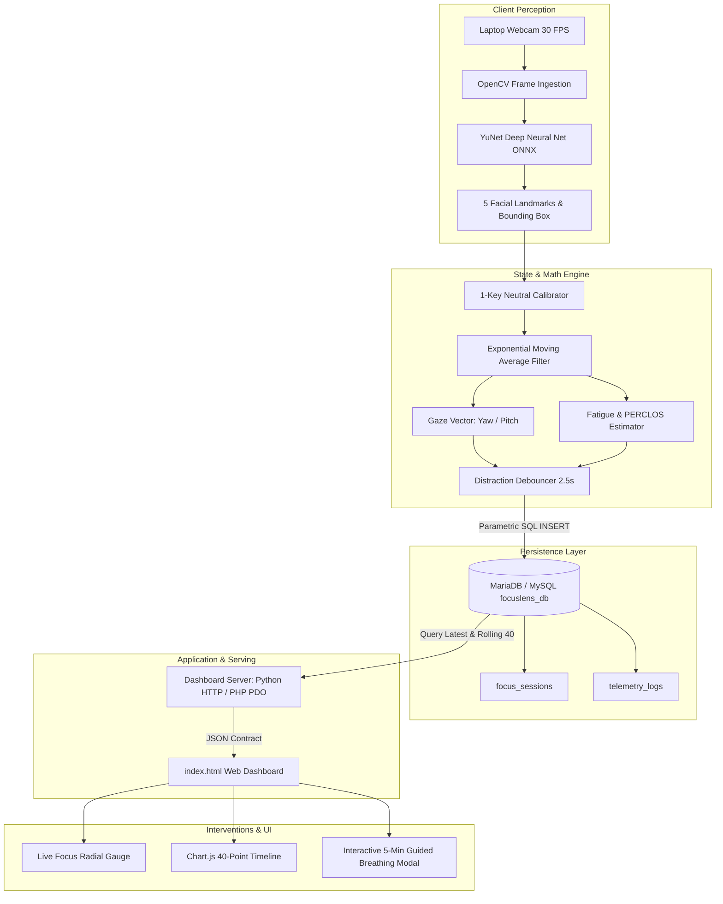
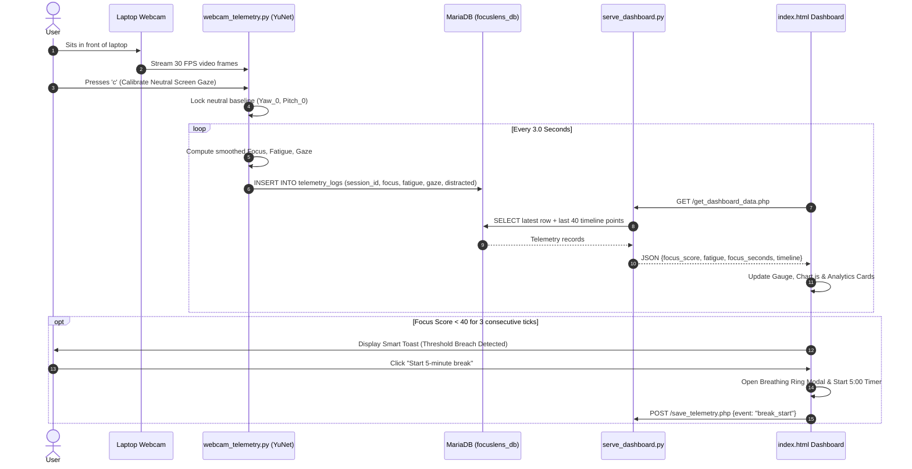

# FocusLens - System Architecture Document

**System:** FocusLens Real-Time Cognitive Engine  
**Document:** End-to-End System Architecture & Component Interactions  
**Version:** 1.0.0  

---

## 1. High-Level Component Topology

FocusLens implements a multi-tier, decoupled architecture designed for local execution without cloud dependencies:

---

## 2. Layer-by-Layer Architecture

### 2.1 The Perception Layer (`webcam_telemetry.py`)
* **Hardware Ingestion:** `cv2.VideoCapture(0)` initializes at $640\times 480$ resolution. Horizontal flipping creates an intuitive mirror-like preview.
* **Neural Inference Engine:** Loads `face_detection_yunet_2023mar.onnx` via `cv2.FaceDetectorYN`. It executes forward passes in $<18\text{ ms}$ on CPU, returning face bounding box and 5 coordinates:
  1. Right Eye $(x, y)$
  2. Left Eye $(x, y)$
  3. Nose Tip $(x, y)$
  4. Right Mouth Corner $(x, y)$
  5. Left Mouth Corner $(x, y)$
  6. Confidence Score ($0.0 – 1.0$)

### 2.2 Telemetry & Calibration Layer
* **Neutral Baseline Register:** Stores baseline $(\text{Yaw}_0, \text{Vert}_0)$ captured when the user presses `c`.
* **Landmark Smoother:** Implements continuous EMA to eliminate high-frequency jitter.
* **Temporal Debouncer:** Maintains a timer when gaze deviates from `Screen`. Flags `is_distracted = 1` only when deviation persists $>2.5$ seconds continuously.

### 2.3 Storage & Persistence Layer (`focuslens_db`)
* Directly managed via MariaDB connector (`mysql.connector` or `mariadb`).
* Auto-probes ports `3306` (standard XAMPP) and `3308` (standalone MariaDB), eliminating environment setup friction.
* Automatically verifies schema and auto-initializes session `#1` on launch.

### 2.4 Application & Dashboard Layer (`serve_dashboard.py` / PHP)
* Dual-compatible serving strategy:
  1. **Python Lightweight Web Server:** Standalone `HTTPServer` serving on `http://127.0.0.1:8000/index.html`. Handles `/get_dashboard_data.php` and `/save_telemetry.php` internally.
  2. **Apache/PHP Stack:** Directly executable via XAMPP with identical SQL contracts.
* **Frontend Dashboard (`index.html`):** Built with Vanilla JavaScript, CSS custom properties, SVG gauge primitives, and Chart.js 4.4.1.

---

## 3. End-to-End Execution Sequence

