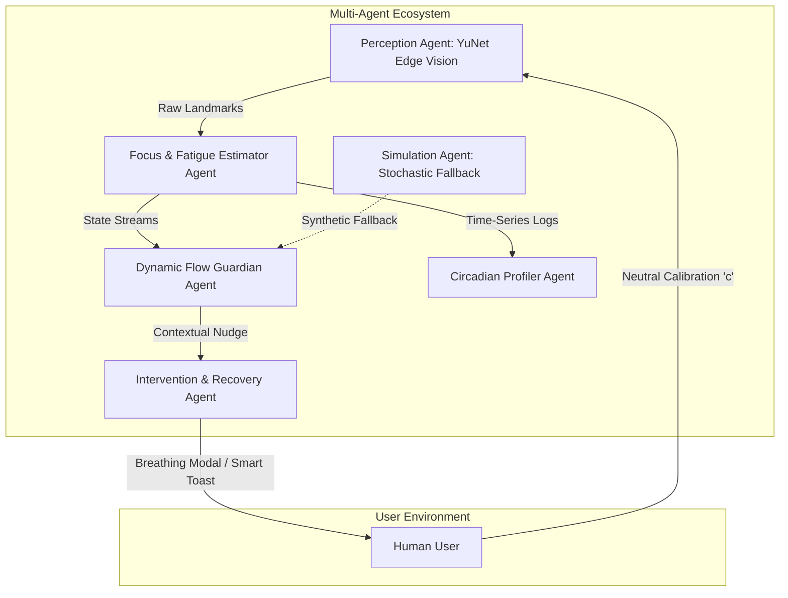

# FocusLens - Autonomous Agents & Cognitive Multi-Agent Architecture

**Document:** AI Agents Specification  
**System:** FocusLens Distributed Multi-Agent Architecture  
**Version:** 1.0.0  

---

## 1. Agentic Design Philosophy
In FocusLens, human productivity and cognitive maintenance are managed not by monolithic scripts, but by specialized **Autonomous Agents** operating asynchronously. Each agent has bounded responsibilities, dedicated perceptual inputs, and cooperative action capabilities.

---

## 2. Core Autonomous Agents

### 2.1 The Perception Agent (Vision Core)
* **Code Implementation:** `webcam_telemetry.py` (Class: `AdaptiveFaceTracker` + `cv2.FaceDetectorYN`)
* **Role:** Continuous perceptual awareness of user presence, facial orientation, and ocular metrics.
* **Autonomous Behaviors:**
  * Self-calibrates input resolution ($640\times 480$) to match camera hardware.
  * Dynamically computes Eye Aspect Ratio (EAR), Nose-to-Eye Yaw Vector, and Pitch ratio.
  * Detects face absence and flags micro-drops without requiring manual triggers.
  * Runs an adaptive low-pass filter to eliminate sensor reflections from prescription glasses.

### 2.2 The Telemetry Simulation Agent
* **Code Implementation:** `simulate_telemetry.py` (Class: `OrganicTelemetrySimulator`)
* **Role:** High-fidelity autonomous emulator generating human-like stochastic telemetry.
* **Autonomous Behaviors:**
  * Cycles through 4 biological states (Deep Focus, Mild Fatigue, Distraction Breach, Post-Break Recovery).
  * Injects low-frequency harmonic drift (sinusoidal waves) and Gaussian micro-jitter to prevent artificial step-function cliffs.
  * Acts as a digital twin for automated testing, CI/CD validation, and privacy-restricted environments.

### 2.3 The Dynamic Flow Guardian Agent
* **Role:** Protects uninterrupted deep work intervals while preventing neurological burnout.
* **Autonomous Decision Logic:**
  * **Flow Protection:** If standard 25-minute Pomodoro time elapses but the user exhibits high focus ($\ge 80\%$) and low fatigue, the agent dynamically silences alerts and extends the session.
  * **Early Burnout Intervention:** If focus drops below $40\%$ with high fatigue at minute 12, the agent recognizes cognitive collapse and triggers an early micro-break before deep frustration sets in.

### 2.4 The Circadian Profiler Agent
* **Role:** Long-term temporal pattern recognition across multi-day MariaDB logs.
* **Autonomous Decision Logic:**
  * Analyzes historical session logs grouped by hour of day using unsupervised clustering (K-Means).
  * Automatically isolates personal peak cognitive windows (e.g., 10:00 AM – 11:30 AM) vs. circadian dips (e.g., 2:30 PM post-lunch slump).
  * Generates scheduling recommendations for high-cognitive (coding/design) vs. low-cognitive (email/meetings) workloads.

### 2.5 The Intervention & Recovery Agent
* **Code Implementation:** `index.html` (Modules: `Alerts`, `Break`, `UI`)
* **Role:** Autonomic down-regulation and ocular recovery.
* **Autonomous Behaviors:**
  * Deploys interactive box breathing pacer ($4\text{s in} \leftrightarrow 4\text{s out}$) to lower heart rate and reset eye convergence.
  * Implements smart snoozing (2 minutes) with progressive intensity if fatigue continues climbing.

---

## 3. Inter-Agent Communication & Synchronization
Agents communicate asynchronously through:
1. **Shared MariaDB Telemetry Store (`telemetry_logs`):** Enables loose coupling between Python computer vision agents and JavaScript/PHP dashboard agents.
2. **Keyboard Calibration Signals:** Key-event interrupts (`c` for neutral calibration, `q` for shutdown) propagate immediately across camera threads.
