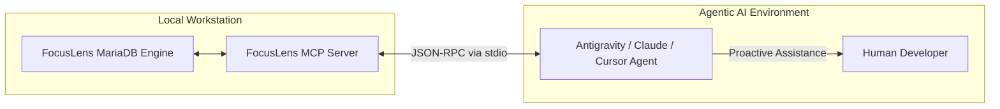

# FocusLens - Model Context Protocol (MCP) Integration Document

**Standard:** Model Context Protocol (MCP)  
**Role:** Exposing Real-Time Cognitive State to Agentic AI Workspaces  
**Version:** 1.0.0  

---

## 1. Overview & Motivation
The **Model Context Protocol (MCP)** enables large language models (LLMs) and coding agents (e.g., Claude Desktop, Antigravity, Cursor) to safely read external tools and resources.

By exposing FocusLens as an **MCP Server**, AI development agents can become **context-aware of the human developer's cognitive state**:
* If FocusLens reports `focus_score: 92%` (Deep Focus), the AI agent automatically delays non-urgent notifications, code review pings, or complex questions.
* If FocusLens reports `fatigue_index: 78` (Severe Fatigue), the AI agent proactively suggests: *"You've been debugging for 90 minutes and cognitive fatigue is elevated. Would you like me to run tests while you take a 5-minute break?"*

---

## 2. FocusLens MCP Architecture



---

## 3. Tool Declarations & Schemas

### 3.1 Tool 1: `get_live_focus_telemetry`
Returns instantaneous cognitive load, fatigue, and distraction status.

#### Tool Definition:
```json
{
  "name": "get_live_focus_telemetry",
  "description": "Fetches real-time cognitive focus score, fatigue index, and gaze direction for the active developer session from FocusLens.",
  "parameters": {
    "type": "object",
    "properties": {
      "session_id": {
        "type": "integer",
        "description": "Active session ID (defaults to 1)",
        "default": 1
      }
    }
  }
}
```

#### Sample Return Payload:
```json
{
  "session_id": 1,
  "focus_score": 86,
  "fatigue_index": 21,
  "gaze_direction": "Screen",
  "is_distracted": 0,
  "state": "Deep Focus",
  "safe_to_interrupt": false
}
```

---

### 3.2 Tool 2: `trigger_guided_break`
Allows an autonomous coding agent to prescribe a micro-break when it observes the developer struggling or experiencing cognitive decline.

#### Tool Definition:
```json
{
  "name": "trigger_guided_break",
  "description": "Triggers the FocusLens 5-minute guided breathing and eye strain relief modal on the user's dashboard.",
  "parameters": {
    "type": "object",
    "properties": {
      "break_type": {
        "type": "string",
        "enum": ["ocular_strain", "box_breathing", "postural_reset"],
        "description": "Type of recovery intervention prescribed."
      }
    },
    "required": ["break_type"]
  }
}
```

---

### 3.3 Tool 3: `query_session_analytics`
Allows an AI agent to summarize the day's focus blocks and generate an evening productivity report.

#### Tool Definition:
```json
{
  "name": "query_session_analytics",
  "description": "Queries historical session duration, productive minutes, and distraction frequency from MariaDB.",
  "parameters": {
    "type": "object",
    "properties": {
      "session_id": { "type": "integer", "default": 1 },
      "window_minutes": { "type": "integer", "default": 60 }
    }
  }
}
```

---

## 4. MCP Configuration for Claude / Antigravity

Add the following block to your `mcp_config.json`:
```json
{
  "mcpServers": {
    "focuslens": {
      "command": "python",
      "args": ["c:/Users/Aadmin/New folder/mcp_server.py"],
      "env": {
        "FOCUSLENS_DB_PORT": "3306"
      }
    }
  }
}
```
