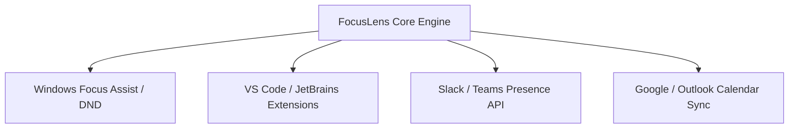

# FocusLens - System Integration & Ecosystem Document

**Document:** Ecosystem Integrations & External Hooks  
**Target Environments:** Operating Systems (Windows 11), IDEs, Messaging Platforms & Calendars  
**Version:** 1.0.0  

---

## 1. System Integration Landscape

FocusLens acts as a central cognitive hub connecting hardware perception to desktop workflows:



---

## 2. Desktop OS Integration: Windows Focus Assist

### Automatic Do-Not-Disturb (DND) Sync
* **Trigger Condition:** Focus Score $\ge 80\%$ for $>3$ consecutive minutes.
* **Mechanism:** FocusLens invokes the Windows WinRT Shell API or registry trigger:
  ```powershell
  # Sets Windows 11 Focus Assist to Priority Only / Alarms Only
  Set-ItemProperty -Path "HKCU:\Software\Microsoft\Windows\CurrentVersion\CloudStore\Store\Cache\DefaultAccount\..." -Name "Data" ...
  ```
* **Benefit:** Blocks banner notifications, emails, and chat pop-ups during deep coding sessions.

---

## 3. IDE Integration (VS Code / JetBrains)

### Live Cognitive Status in IDE Status Bar
* FocusLens exposes a lightweight localhost endpoint (`http://localhost:8000/get_dashboard_data.php`).
* A VS Code extension can read this every 5 seconds to render a live icon in the bottom status bar:
  * 🟢 `FocusLens: 88% (Deep Flow)`
  * 🟡 `FocusLens: 58% (Fatigue Rising)`
  * 🔴 `FocusLens: 31% (Take a Break)`

---

## 4. Team Chat & Presence Sync (Slack / Microsoft Teams)

### Dynamic Status Updates
When entering deep work, FocusLens can dispatch an automated webhook to the user's workspace:
* **Payload:**
  ```json
  {
    "status_text": "In Deep Flow (FocusLens: 92%)",
    "status_emoji": ":brain:",
    "status_expiration": 1800
  }
  ```
* **Benefit:** Signals to colleagues that the developer is focused and should not be tapped for ad-hoc interruptions.

---

## 5. Calendar Scheduling Integration

### Peak Productivity Blocking
* The Circadian Profiler agent computes the user’s weekly peak cognitive hours (e.g. 10:15 AM – 12:00 PM).
* FocusLens uses Google Calendar API to automatically create recurring "Deep Work Reserve" calendar events, blocking incoming meeting invites during those peak physiological hours.
