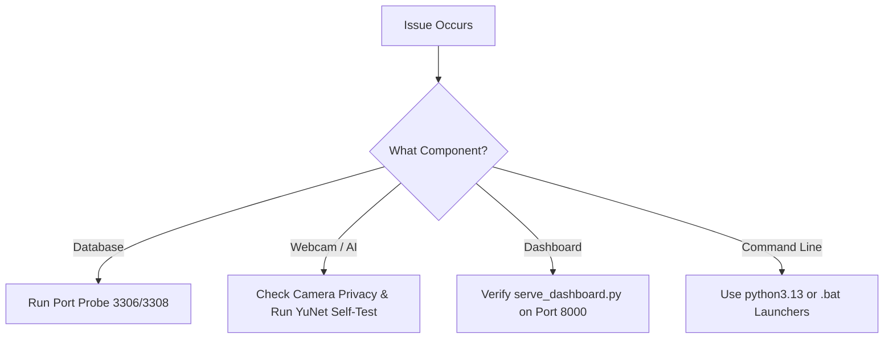

# FocusLens - Debugging & Troubleshooting Handbook

**Document:** Operational Troubleshooting & Triage Guide  
**Target:** Developers, Testers & Presentation Presenters  
**Version:** 1.0.0  

---

## 1. Quick Triage Flowchart



---

## 2. Common Issues & Resolution Matrix

### Issue 1: `The term 'python' is not recognized`
* **Root Cause:** On Windows, the Microsoft Store / WindowsApps package often registers the executable as `python3.13.exe` instead of `python.exe`.
* **Instant Solution:**
  * Double-click the provided batch file: **`run_webcam.bat`** or **`run_dashboard.bat`**.
  * Or in PowerShell, use: `python3.13 script_name.py`.
  * Or create an alias: `Set-Alias python python3.13`.

---

### Issue 2: MariaDB `ERROR 1046 (3D000): No database selected`
* **Root Cause:** MariaDB console prompt is currently in `[(none)]` instead of a specific database.
* **Instant Solution:**
  Run in MariaDB terminal:
  ```sql
  CREATE DATABASE IF NOT EXISTS focuslens_db;
  USE focuslens_db;
  ```
  *(Note: The Python scripts automatically perform this on cold start.)*

---

### Issue 3: Camera shows "Could not access laptop webcam"
* **Root Cause:** Another application (e.g., Zoom, Microsoft Teams, Discord, or Windows Camera app) has an exclusive hardware lock on camera index 0.
* **Instant Solution:**
  1. Close any running video conferencing apps in Task Manager.
  2. In Windows Settings $\rightarrow$ *Privacy & Security* $\rightarrow$ *Camera*, verify *Let desktop apps access your camera* is toggled **ON**.

---

### Issue 4: False Distraction Alerts While Facing the Screen
* **Root Cause:** Different desk heights, laptop screen tilt angles, or reflections on eyeglasses cause the default neutral angle to deviate.
* **Instant Solution:**
  1. Sit in your natural, comfortable work posture.
  2. In the webcam window, press **`c`** on your keyboard.
  3. The on-screen HUD will flash *"Calibrating Screen Gaze..."* and permanently lock your personal neutral coordinates.

---

### Issue 5: Dashboard Displays "Demo data (PHP not reachable)"
* **Root Cause:** The browser is opening `index.html` via `file:///` protocol rather than through an active web server.
* **Instant Solution:**
  1. Double-click **`run_dashboard.bat`** (launches `serve_dashboard.py` on port 8000).
  2. Open **`http://localhost:8000/index.html`** in your browser.
  3. The top status indicator will switch to green: **`Backend connected`**.

---

### Issue 6: `AttributeError: module 'cv2' has no attribute 'CascadeClassifier'`
* **Root Cause:** OpenCV 5.0 pre-release packages separate legacy 1990s CascadeClassifiers.
* **Instant Solution:**
  FocusLens uses OpenCV’s modern official deep neural network: **YuNet** (`cv2.FaceDetectorYN`). It is 100% immune to CascadeClassifier attribute errors.

---

## 3. Diagnostic Health Check Command
Run this single command in PowerShell to verify your entire system health:
```powershell
python3.13 -c "
import cv2, mysql.connector, urllib.request, os

print('--- FocusLens Diagnostic Check ---')
# 1. OpenCV & AI Model
print('1. OpenCV Version:', cv2.__version__)
print('   YuNet Model Present:', os.path.exists('face_detection_yunet_2023mar.onnx'))

# 2. Database
try:
    conn = mysql.connector.connect(host='127.0.0.1', port=3306, user='root', password='', database='focuslens_db')
    print('2. MariaDB Port 3306: ONLINE')
    conn.close()
except Exception as e:
    print('2. MariaDB Port 3306:', e)

# 3. Web Dashboard
try:
    with urllib.request.urlopen('http://localhost:8000/get_dashboard_data.php', timeout=2) as r:
        print('3. Dashboard Server: ONLINE (HTTP 200)')
except Exception as e:
    print('3. Dashboard Server: OFFLINE (Start via run_dashboard.bat)')
print('----------------------------------')
"
```
